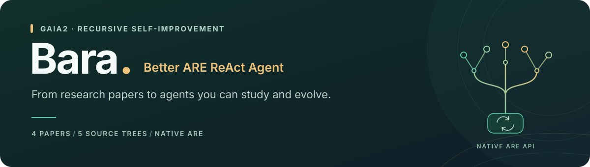

<div align="center">



<h3>RSI research, built on native ARE ReAct.</h3>

<p>Study the papers. Compare the agents. Build your next iteration.</p>

<p>
<a href="https://github.com/facebookresearch/meta-agents-research-environments"></a>
<a href="pyproject.toml"></a>
<a href="LICENSE"></a>
</p>

<p>
<a href="#collection"><b>Agent collection</b></a>
&nbsp; · &nbsp;
<a href="#quick-start"><b>Quick start</b></a>
&nbsp; · &nbsp;
<a href="#papers"><b>Papers & sources</b></a>
&nbsp; · &nbsp;
<a href="README.zh-CN.md"><b>中文说明</b></a>
</p>

</div>

**Better ARE ReAct Agent** collects practical implementations inspired by recent
recursive self-improvement papers. It is for researchers who want to compare
agent designs, run ablations, and study further harness evolution on **GAIA2**.

> [!NOTE]
> **Research reimplementations, without a fidelity guarantee.** These are independent starting points, not the authors' complete final agents or reproductions of their reported scores. [Scope and differences →](docs/SOURCES.md)

<a id="collection"></a>

## 🧩 Agent collection

Four papers, five enhanced variants, and an unchanged native baseline.

<table>
<tr>
<td width="50%" valign="top">
<h3>🛠️ AutoSaddler</h3>
<p><sub><b>PROMPT & TASK POLICY</b></sub></p>
<p>Communication, ambiguity, and ordered subtasks. A prompt-centered starting point for studying task policy.</p>
<p><a href="https://arxiv.org/abs/2608.23041"><b>Paper ↗</b></a> &nbsp; · &nbsp; <a href="docs/SOURCES.md#autosaddler">Implementation notes →</a></p>
</td>
<td width="50%" valign="top">
<h3>🧭 ActiveSaddler</h3>
<p><sub><b>ACTION GUARDS</b></sub></p>
<p>Case-study repairs for email signatures and calendar ambiguity, applied before native tool execution.</p>
<p><a href="https://arxiv.org/abs/2610.00906"><b>Paper ↗</b></a> &nbsp; · &nbsp; <a href="docs/SOURCES.md#activesaddler">Implementation notes →</a></p>
</td>
</tr>
<tr>
<td width="50%" valign="top">
<h3>⚖️ ParetoSaddler</h3>
<p><sub><b>QUALITY & COST</b></sub></p>
<p>Two agent-side variants, I-23 and I-22, for comparing task guidance and efficiency-oriented behavior.</p>
<p><a href="https://arxiv.org/abs/2611.02079"><b>Paper ↗</b></a> &nbsp; · &nbsp; <a href="docs/SOURCES.md#paretosaddler">Implementation notes →</a></p>
</td>
<td width="50%" valign="top">
<h3>🔁 HarnessMM</h3>
<p><sub><b>DECISION REUSE</b></sub></p>
<p>A public continuation controller that reuses already-decided actions when tool feedback meets their conditions.</p>
<p><a href="https://arxiv.org/abs/2610.32813"><b>Paper ↗</b></a> &nbsp; · &nbsp; <a href="docs/SOURCES.md#harnessmm">Implementation notes →</a></p>
</td>
</tr>
</table>

<details>
<summary><b>View all six agent IDs</b></summary>

| Agent ID | Implementation |
| --- | --- |
| `baseline` | Native ARE ReAct, unchanged |
| `autosaddler-appendix` | AutoSaddler agent-side policy |
| `activesaddler-appendix` | ActiveSaddler case-study policy and guards |
| `paretosaddler-i23-appendix` | ParetoSaddler I-23 policy |
| `paretosaddler-i22-appendix` | ParetoSaddler I-22 policy and terminal-text conversion |
| `harnessmm-public-continuation` | HarnessMM public deterministic continuation |

Use `baseline` for the native control. Each variant keeps the same scenario tool
set; environment-tool extensions described in the papers are not bundled.

</details>

<a id="quick-start"></a>

## 🚀 Quick start

From the repository root, install into a dedicated environment and run the offline check:

```sh
uv venv .uv-venv/better-are-react-agent --python 3.12
uv pip install --python .uv-venv/better-are-react-agent/bin/python -e .
.uv-venv/better-are-react-agent/bin/better-are-react-agent smoke
```
The check executes real ARE steps and tools with scripted responses. It needs no
API key or benchmark download and does not measure GAIA2 success.

## 🔌 One interface, every variant

Choose the implementation when creating the native agent:

```python
from better_are_react_agent import create_agent

agent = create_agent(
    llm_engine,
    base_agent_config,
    variant="harnessmm-public-continuation",
)
agent.tools = scenario_tools
```
Every variant returns ARE's **`BaseAgent`**, keeping the native reasoning loop and
JSON tool executor. Your evaluator provides the model engine, scenario tools,
notifications, clock, and scoring.

<details>
<summary><b>Native factory signature & entry points</b></summary>

Named factories match `are_simulation_react_json_agent`'s two-argument interface:

```python
from better_are_react_agent.factories import autosaddler_appendix

agent = autosaddler_appendix(llm_engine, base_agent_config)
```

Factories are registered in the Python entry-point group `are.react_agents`.
Installation does not change another program's selected agent automatically.
See the [integration contract](docs/INTEGRATION.md) for factory discovery,
content identities, and checkpoint state.

</details>

<a id="papers"></a>

## 📚 Papers & sources

The collection draws on the following papers. Please cite the original work when
using a corresponding idea or implementation in your research.

- **[AutoSaddler](https://arxiv.org/abs/2608.23041)** — Automatic Harness Optimization with Durable Updates from Agent Execution Traces. [arXiv:2608.23041](https://arxiv.org/abs/2608.23041)
- **[ActiveSaddler](https://arxiv.org/abs/2610.00906)** — Automated Curriculum Learning for Agent Harness Optimization. [arXiv:2610.00906](https://arxiv.org/abs/2610.00906)
- **[ParetoSaddler](https://arxiv.org/abs/2611.02079)** — Pareto-Guided Optimization of Agent Harnesses for Quality and Cost. [arXiv:2611.02079](https://arxiv.org/abs/2611.02079)
- **[HarnessMM](https://arxiv.org/abs/2610.32813)** — Recursive Self-Improvement for Harness Token Efficiency. [arXiv:2610.32813](https://arxiv.org/abs/2610.32813)

Original repositories, appendix sections, implemented components, and missing
pieces are mapped in the [source notes](docs/SOURCES.md).

## ✅ Validation & development

<a href="https://github.com/zhangdw156/better-are-react-agent/actions/workflows/test.yml"></a>

Checks cover native tool execution, variant isolation, continuation reuse,
notification invalidation, and controller-state recovery. CI runs on **Python
3.12 and 3.13**. Real-model benchmark results are not yet reported.
[Validation scope →](docs/VALIDATION.md)

<details>
<summary><b>Run the development checks</b></summary>

```sh
uv pip install --python .uv-venv/better-are-react-agent/bin/python -e '.[dev]'
.uv-venv/better-are-react-agent/bin/python -m pytest
.uv-venv/better-are-react-agent/bin/ruff check src tests
.uv-venv/better-are-react-agent/bin/python -m build
```

When adding a variant, record its paper, implementation choices, and differences
in the catalogue and source notes. Keep public component ports distinct from
reconstructions, and use Angular-style commit messages.

</details>

---

<p align="center">
<sub>Built for open RSI research · <a href="LICENSE">MIT</a> · HarnessMM component: Apache-2.0 · <a href="THIRD_PARTY_NOTICES.md">Attribution & licenses</a></sub>
</p>
