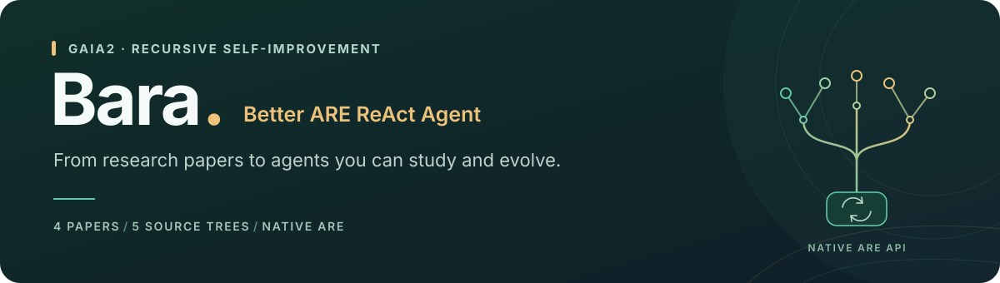

<div align="center">



<h3>一个目录，一份进化后的 ARE ReAct 源码。</h3>

<p>读源码，跑评测，继续你的 RSI 研究。</p>

<p>
<a href="https://github.com/facebookresearch/meta-agents-research-environments"></a>
<a href="pyproject.toml"></a>
<a href="LICENSE"></a>
</p>

<p><a href="#collection"><b>源码合集</b></a> &nbsp; · &nbsp; <a href="#quick-start"><b>快速开始</b></a> &nbsp; · &nbsp; <a href="#data"><b>数据与评测</b></a> &nbsp; · &nbsp; <a href="#papers"><b>论文</b></a> &nbsp; · &nbsp; <a href="README.md"><b>English</b></a></p>

</div>

**Bara**（Better ARE ReAct Agent）根据四篇 RSI 论文的公开代码与附录，整理了五份
ARE ReAct 研究实现。**每个 agent 子目录就是一份可以单独安装、修改和评测的 ARE 源码**，
方便研究者阅读实现、比较方法并继续开展 RSI 实验。

<a id="collection"></a>

## 🧩 源码合集

<table>
<tr>
<td width="50%" valign="top"><h3>🛠️ AutoSaddler</h3><p><sub><b>任务策略与工具算法</b></sub></p><p>沟通、消歧、任务顺序，以及公开检索和批量工具算法的改写。</p><p><a href="autosaddler/"><b>查看源码 →</b></a> · <a href="https://arxiv.org/abs/2608.23041">论文 ↗</a></p></td>
<td width="50%" valign="top"><h3>🧭 ActiveSaddler</h3><p><sub><b>动作修正</b></sub></p><p>在原生模型调用步骤中修正邮件签名与日历替换歧义。</p><p><a href="activesaddler/"><b>查看源码 →</b></a> · <a href="https://arxiv.org/abs/2610.00906">论文 ↗</a></p></td>
</tr>
<tr>
<td width="50%" valign="top"><h3>⚖️ ParetoSaddler</h3><p><sub><b>质量与成本</b></sub></p><p>来自不同搜索过程的两份独立源码，包含任务策略及最终回复处理。</p><p><a href="paretosaddler-i23/"><b>I-23 源码 →</b></a> · <a href="paretosaddler-i22/"><b>I-22 源码 →</b></a> · <a href="https://arxiv.org/abs/2611.02079">论文 ↗</a></p></td>
<td width="50%" valign="top"><h3>🔁 HarnessMM</h3><p><sub><b>复用已决定的动作</b></sub></p><p>当工具反馈满足计划中的条件时，复用后续动作，减少模型调用。</p><p><a href="harnessmm/"><b>查看源码 →</b></a> · <a href="https://arxiv.org/abs/2610.32813">论文 ↗</a></p></td>
</tr>
</table>

```text
Bara/
├── autosaddler/
├── activesaddler/
├── paretosaddler-i23/
├── paretosaddler-i22/
├── harnessmm/
└── src/bara/                 # 命令行与评测工具
```

每份目录都有自己的 `are/`、`pyproject.toml`、`uv.lock`、说明、来源记录和测试。
agent 改动在各自的 `are/simulation/agents/default_agent/` 中；`src/bara/` 提供命令行和评测工具。
每个 agent 目录都可以单独复制、安装和使用。
[供已有评测程序使用 →](docs/USAGE.md)

<a id="quick-start"></a>

## 🚀 快速开始

在合集根目录执行：

```sh
uv sync
uv run bara list
uv run bara smoke autosaddler
```

离线检查用预设模型回复执行原生 ARE 工具。
Bara 会自动准备所选源码目录的 `.venv`。

| 命令 | 用途 |
| --- | --- |
| `uv run bara benchmark autosaddler --help` | 普通数据集评测参数 |
| `uv run bara gaia2 harnessmm --help` | 完整 GAIA2 评测流程参数 |
| `uv run bara judge autosaddler --help` | 离线评分参数 |
| `uv run bara smoke` | 检查全部源码的原生执行 |
| `uv run bara test` | 运行本地测试 |
| `uv run bara build` | 分别打包五份 ARE 源码 |

<a id="data"></a>

## 🗂️ 数据与 mini 全量评测

评测时通过 `--hf-dataset` 在线读取
[官方 GAIA2 数据集](https://huggingface.co/datasets/meta-agents-research-environments/gaia2)。
场景从 Hugging Face 按需加载，运行期间需要保持网络可用。

下面的命令运行整个 `mini` 子集，每题一次。将模型名和接口地址换成实际值，
并配置服务所需的凭据。示例使用兼容 OpenAI 格式的 agent 和 judge 接口；
judge 默认沿用 `--provider local`。

```sh
uv run bara benchmark harnessmm \
  --hf-dataset meta-agents-research-environments/gaia2 \
  --hf-config mini \
  --model openai/YOUR_MODEL \
  --provider local \
  --endpoint http://localhost:8000/v1 \
  --judge_model openai/YOUR_JUDGE_MODEL \
  --judge_endpoint http://localhost:8001/v1 \
  --num_runs 1
```

默认读取 `validation`，不设置 `--limit` 就是所选子集的全量。
`--num_runs 1` 表示每题一次；不传这个参数时，默认每题三次。
将 `harnessmm` 换成其他源码目录名，即可评测对应实现。
结果自动保存到 `runs/<source>/<timestamp>/`。

如果使用本地数据，`--dataset` 接受存放原生 ARE 场景 JSON 的目录，或列出场景路径的
JSONL 文件。使用本地 Parquet 时，先将每行的 `data` 字段导出为场景 JSON 文件。
包含 Agent2Agent 和噪声阶段的完整协议使用 `uv run bara gaia2 <source>`。

[本地数据目录、模型设置和完整评测流程 →](docs/EVALUATION.md)

## 🔌 原生 ARE 接口

选定源码目录后，使用原生工厂创建 agent：

```python
from are.simulation.agents.default_agent.agent_factory import are_simulation_react_json_agent

agent = are_simulation_react_json_agent(llm_engine, base_agent_config)
agent.tools = scenario_tools
```

导入 ARE 前，先选择源码目录及其环境。工厂返回原生 `BaseAgent`。
Bara 的评测程序使用所选源码中的 builder、工具、user simulator 和 judge。
已有评测程序的接入方式见[使用说明](docs/USAGE.md)。

<a id="papers"></a>

## 📚 论文与来源

- **[AutoSaddler](https://arxiv.org/abs/2608.23041)** — Automatic Harness Optimization with Durable Updates from Agent Execution Traces.
- **[ActiveSaddler](https://arxiv.org/abs/2610.00906)** — Automated Curriculum Learning for Agent Harness Optimization.
- **[ParetoSaddler](https://arxiv.org/abs/2611.02079)** — Pareto-Guided Optimization of Agent Harnesses for Quality and Cost.
- **[HarnessMM](https://arxiv.org/abs/2610.32813)** — Recursive Self-Improvement for Harness Token Efficiency.

每份目录的 `SOURCE.json` 记录来源，`CHANGES.md` 说明已实现内容与差异。
[完整来源说明 →](docs/SOURCES.md)

<details>
<summary><b>本地验证与贡献</b></summary>

测试覆盖原生工具执行、待执行模型请求恢复、各方法的特定行为，以及合成数据集评测。
[验证范围 →](docs/VALIDATION.md)

新方法同样放入独立 ARE 源码目录，附上论文、来源和改动说明，保持原生工厂接口。
提交信息使用 Angular 风格。

</details>

---

<p align="center"><sub>为开放 RSI 研究而构建 · <a href="LICENSE">MIT</a> · HarnessMM 控制器：Apache-2.0 · <a href="THIRD_PARTY_NOTICES.md">来源与许可</a></sub></p>
